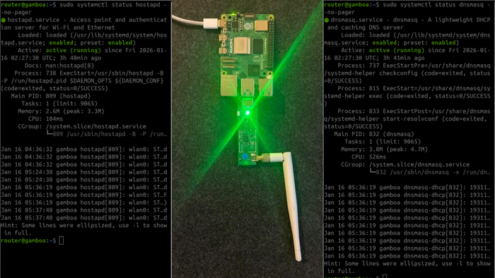

## A. Emilio DiStefano

I’m Emilio - a results-driven software engineer dedicated to the development of effective, efficient, low-cost robotics, IoT, and embedded systems solutions.  Here are some of my projects: 

# NeuroMux 

  

NeuroMux is a CI/CD tool that catches integration issues between hardware and software. Checks for drift with every revision so HW and SW engineers can focus on what they do best. the systme works fully deterministically, with optional AI functions that can call local and/or cloud-based models.

### [NeuroMux](https://neuromux.io)

 
 

# Swarm Control  

   

### [swarm_control_core](https://github.com/AEmilioDiStefano/swarm_control_core)

**Swarm Control Core** is a ROS2 package that allows the user to control heterogeneous swarms of robots.  It includes an interactive browser UI that allows users to control swarm robots while seeing from their persoective via integrated, USB, serial, and other camera types.  The package is optimized for low-latency FPV on a local network.  It includes basic security features and automated camera integration which scrapes camera metadata and sets a camera profile that can be used for each individual robot regardless of camera type.  

**Swarm Control Core** acts as a baseline for **Swarm Control Pro**, which includes a wide variety of additional features such as remote operation capabilities from a remote browser, robuts security features, and automated onboarding of new build types (ground based, aerial, etc) to heterogeneous robot swarms.  **Swarm Control Pro** is optimized for use in mission-critical use-cases such as military, law enforcement, emergency response/rescue, and other highly sensitive applications.  For more information on the non-public proprietary **Swarm Control Pro** package, contact **[emilio@vitruvian.systems](emilio@vitruvian.systems)** 

   
   

# FPV Router

  

### [FPV Router](https://github.com/AEmilioDiStefano/FPV_router)

This Pi-powered FPV router uses a single-board computer with a full Linux operating system for **ultra-customizable routing**.  Optimized for **low-latency video transfer for FPV robotics operations**, this router outperforms even high-end travel router models at a price comparable to that of a mid-range travel router.  Use this router to control robot swarms, or customize it to virtually any end that you can think of.

This project’s source code is licensed under the PolyForm Noncommercial License 1.0.0, which allows personal and noncommercial use but prohibits commercial use without obtaining a separate commercial license from me or my company.

 
 

# Build Your Own Robot Tutorial (Author) 

   

### [Robot Build Tutorial](https://github.com/AEmilioDiStefano/ros2_ws_minimal)

This minimal (headless) version of the **Legion Control Workspace** contains all of the software needed to build and control one or several robots from a remote location.  While the **Legion Control Workspace** is designed for laptops or control computers, **Legion Control Workspace Minimal** is designed to be cloned onto the robots themselves.  Included is a comprehensive tutorial complete with visual and written build instructions to build ROS2 robots ready for autonomous functions for under $120 USD in materials (each). 

This project’s source code is licensed under the PolyForm Noncommercial License 1.0.0, which allows personal and noncommercial use but prohibits commercial use without obtaining a separate commercial license from me or my company.

 
 
